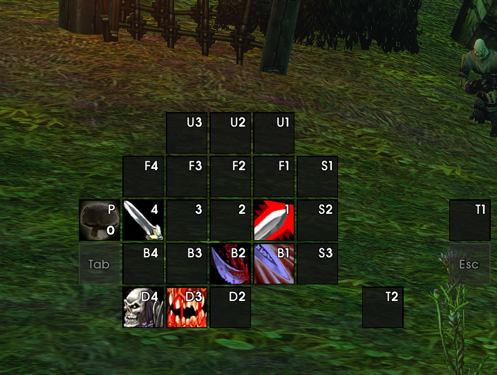
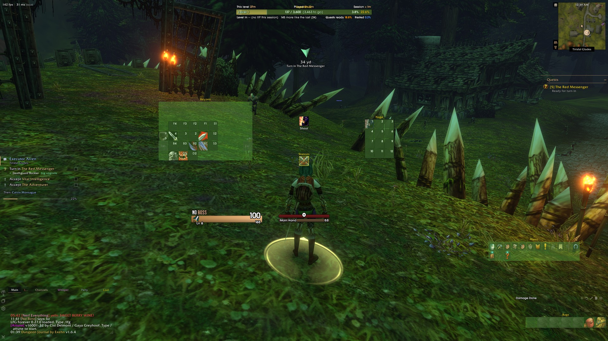
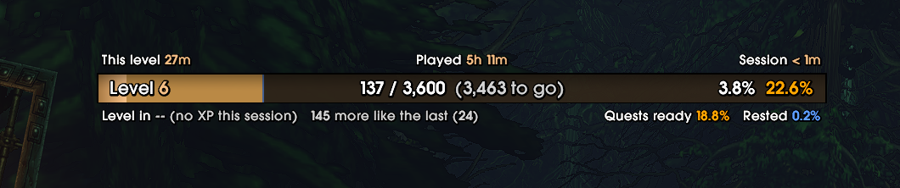
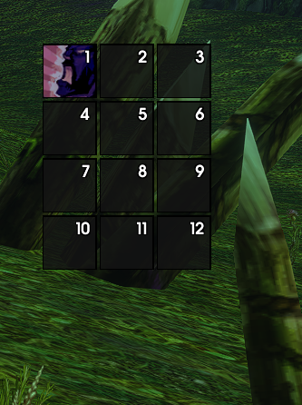
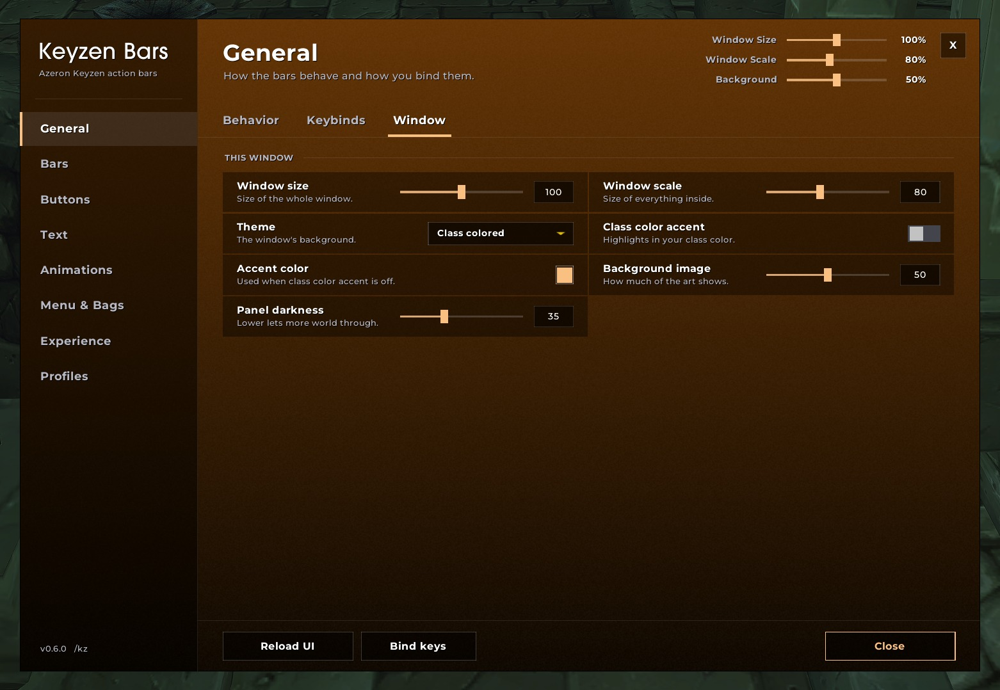
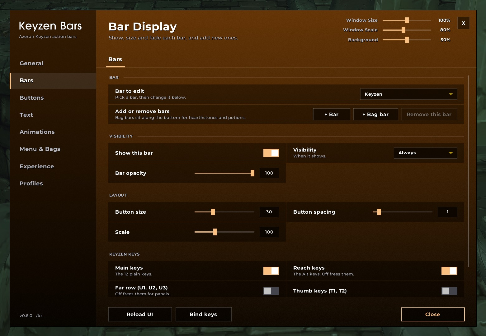
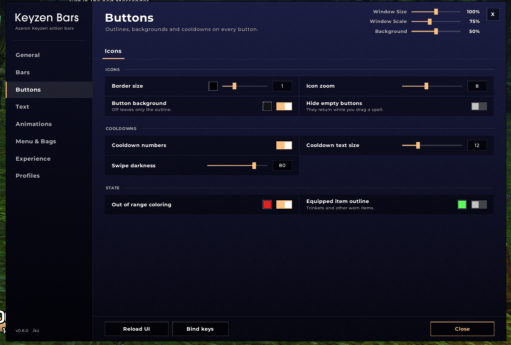
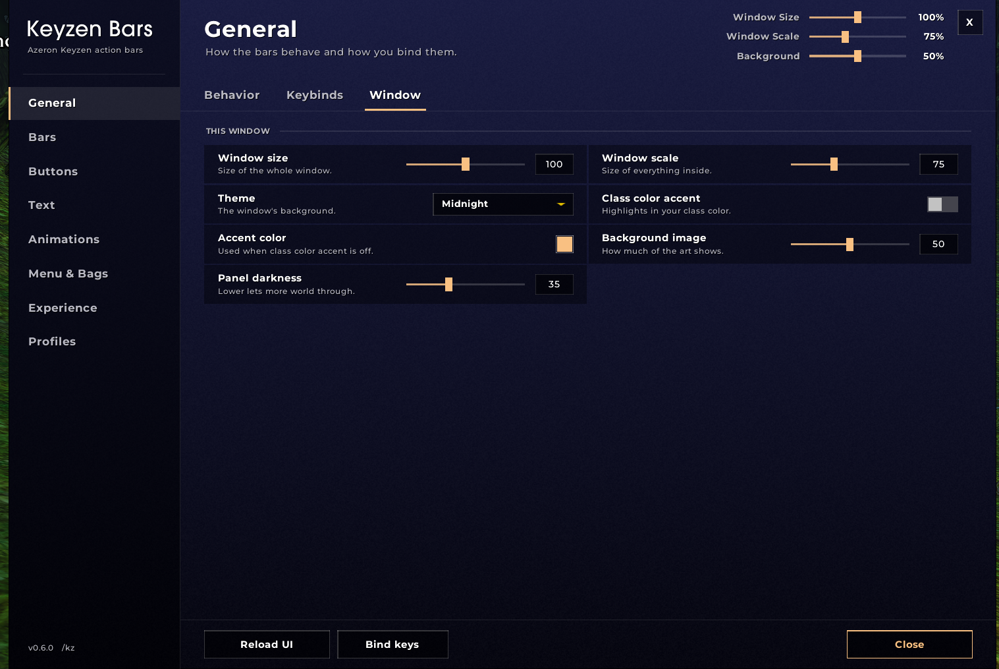
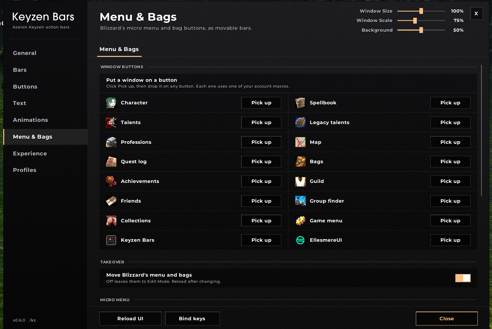

# Keyzen Bars

Action bars laid out like the Azeron Keyzen keypad, for WoW Forever (Interface 16001).

## What it does

- **Keyzen bar:** buttons placed where the keys sit on the Azeron Keyzen, with finger labels and an Alt layer for the reach keys.
- **Naga grid:** a 12-button grid for a Razer Naga side panel.
- **Stance bar and extra bars:** add as many bars as you like, each with its own size, spacing, fading and bar page.
- **Its own keybinds:** hover a button and press a key, straight from the bar. Shift no longer flips your bar page by accident.
- **Blizzard's bars hidden:** the micro menu and bag bar are moved into movable Keyzen bars with orientation, size and fading options.
- **Shaman totem bar:** Blizzard's call totem bar becomes a movable Keyzen bar with the Keyzen button look, and size, spacing, orientation and fading options.
- **Window buttons:** one click puts Character (with your portrait), Map, Spellbook, Talents and more on any button.
- **New spells on your bars:** spells you learn drop onto the first empty button. This can be switched off.
- **Experience bar:** a class gradient bar with time this level, played and session time, XP per hour, time to level, kills to level, quest XP ready to hand in, and rested XP.
- **Profiles:** share one setup across characters, or copy single modules between profiles.
- **Options window:** type /kz. It has a settings search, themes (class colored, Midnight and Dark), window size and scale sliders, and opacity sliders.

## Screenshots

## Commands

- `/kz`: open or close the options.
- `/kz unlock` / `/kz lock`: move the bars.

## Install

Copy the `KeyzenBars` folder into `World of Warcraft\_classic_beta_\Interface\AddOns\` and restart the game.

## Credits and licenses

- Keyzen Bars itself is under the MIT License. See `LICENSE`.

- LibActionButton-1.0 (ElvUI build), LibStub and CallbackHandler-1.0 are included under their own licenses. See `Libs\LibActionButton-1.0\LICENSE.txt`.
- The fonts are free fonts under the SIL Open Font License 1.1, and Ubuntu is under the Ubuntu Font Licence 1.0. The license text for each font is in `Licenses\`: Montserrat, Barlow Condensed, Changa, Cinzel, Cinzel Decorative, Exo, Fira Sans, Geist, Inter, Oswald, Poppins, Russo One and Ubuntu.
